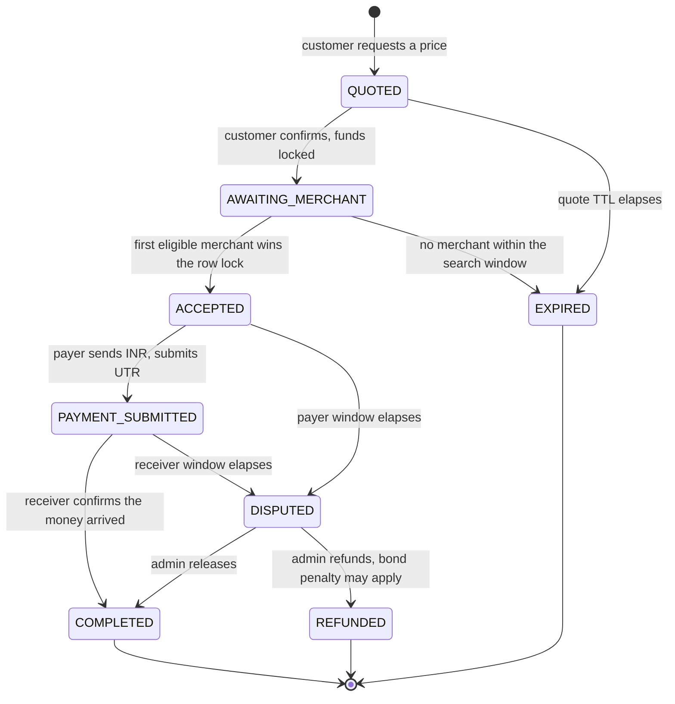

# PRD — Custodial USDT Wallet and P2P Settlement Platform (v1)

**Status:** Draft 1 · **Date:** 2026-11-16 · **Branch:** `feat/v1-rebuild`
**Source:** Derived from the grilling session — see `decisions/grilling.md`, rounds 1–5
(36 decisions). Reference material: `PandaPay SOW & Engineering Master Blueprint
V2.0`, `Crypto_UPI_Settlement_SOW V1.0` (superseded), `decisions/IDEA.md`.

> The reference documents are **input, not requirement**. Where this PRD and a
> reference document disagree, this PRD wins. Each such divergence is recorded
> in section 16 with its reason.

---

## 1. Summary

A custodial platform that holds USDT on BNB Smart Chain for its users and lets
them convert between USDT and Indian rupees through vetted liquidity merchants.

The platform custodies the crypto and runs the escrow. It **never touches
rupees**. Rupees move bank-to-bank between the customer and the merchant; the
platform records the UTR as evidence and moves the USDT.

Three roles share one web application: **customer**, **merchant** (liquidity
provider), and **admin**.

---

## 2. Problem and context

Indian crypto holders cannot easily turn USDT into spendable rupees. Exchange
withdrawal rails are slow, intermittent, and poorly suited to small amounts.
Peer-to-peer trading fills the gap, but the common ad-board model asks a person
who wants to move money to behave like a trader: browse counterparties, compare
rates, and absorb counterparty risk themselves.

This platform quotes one price, finds a merchant automatically, and holds
escrow until settlement is confirmed. The customer sees a price and a countdown.

**Why the platform does not touch rupees.** Holding customer rupees requires an
RBI payment-aggregator or prepaid-instrument licence, or a sponsor bank. That
makes the project a regulated-entity undertaking rather than a software one. The
no-INR-custody rule is a deliberate constraint, and much of this design follows
from it.

---

## 3. Goals and non-goals

### Goals (v1)

- Hold USDT on BEP-20 custodially, on a correct double-entry ledger.
- Let a customer deposit, send, and withdraw USDT.
- Let a customer buy or sell USDT against rupees, through a merchant, with
  escrow on both sides.
- Prove correctness under concurrency on BSC testnet before any real money.

### Non-goals (v1)

- No UPI QR scan-and-pay. (Phase 2. The engine is built to accept it.)
- No gift cards, game top-ups, or the Rooter Playwright worker.
- No utilities: recharge, DTH, bill payment.
- No verification tiers or social account linking.
- No native iOS or Android applications. No contract exists for them.
- No weekly merchant bonus pool, its cutoff job, or its clawback logic.
- No staking. Permanently removed and not to be reintroduced.
- No mainnet operation. v1 ends on testnet.

---

## 4. Users and roles

| Role | Who they are | What they do |
|---|---|---|
| **Customer** | A person holding or wanting USDT | Deposits, sends and withdraws USDT. Buys or sells USDT for rupees. |
| **Merchant** | A vetted liquidity provider | Supplies USDT to buyers and rupees to sellers. Bonds USDT against rupee obligations. Earns on spread. |
| **Support** | Internal staff | Reads everything. Answers tickets. Annotates disputes. **Moves no money.** |
| **Super admin** | Platform owner | Everything, behind MFA and a mandatory reason code. |

A merchant is a **liquidity provider**, not a shop accepting payment.

---

## 5. The money model

Three rules govern every balance change. They are not negotiable and no feature
may bypass them.

1. **The ledger is the only truth.** Balances are derived from balanced
   double-entry journal entries. No code ever writes a balance column directly.
   An admin correction is a compensating journal entry with an author and a
   reason, exactly like every other movement.
2. **Every money operation is atomic, idempotent and auditable.** Order
   creation, acceptance and settlement each require an `Idempotency-Key`.
3. **The platform can only enforce what it custodies.** Every control in this
   design reduces to this sentence.

### 5.1 Money representation

| Quantity | Storage | Notes |
|---|---|---|
| USDT | `NUMERIC(38,18)` | Matches BEP-20's 18 decimals exactly. |
| INR | `NUMERIC(20,2)` | |

Values cross the application boundary as **strings**. All arithmetic uses a
decimal library. A JavaScript `number` never holds money.

Rounding happens only at user-facing boundaries, and conservatively: **customer
payouts round down, customer payables round up.** The platform is never short by
construction. Residues are sub-paisa and invisible to users.

Every rounding residue posts to a dedicated **`ROUNDING` ledger account.** A
residue that is silently dropped produces an unbalanced journal, which makes the
reconciliation alert fire permanently, which teaches everyone to ignore it — and
an ignored reconciliation alert is where real losses hide.

### 5.2 Wallet buckets

Each user holds one wallet per asset, split into ledger accounts:

- **Available** — spendable now.
- **Locked** — escrowed against an open order. Not spendable.
- **Bonded** — a merchant's collateral against a rupee obligation. Not spendable.
- **Pending** — deposits seen on chain but not yet confirmed.

---

## 6. The P2P engine

### 6.1 Shape

The platform quotes a price, broadcasts the order to every eligible merchant at
once, and the **first merchant to accept wins atomically.** The customer never
browses merchants and never negotiates.

The platform therefore owns the price, and owns the spread risk.

### 6.2 Order denomination

A customer enters **either** a USDT quantity **or** an INR amount. The system
solves for the other side. The quote snapshot stores both figures plus a flag
recording which side was authoritative. The side the customer typed is exact;
the derived side absorbs the remainder.

### 6.3 Sell-side — customer sells USDT, merchant pays rupees

Worked example at a quoted sell rate of ₹97.00:

| Step | Effect |
|---|---|
| Customer confirms a 100 USDT sell | 100 USDT: Available → Locked |
| Merchant accepts | 100 USDT of the **merchant's** balance: Available → Bonded |
| Merchant pays ₹9,700 to the customer's bank, submits UTR | No ledger movement |
| **Customer confirms receipt** | Settlement journal posts |
| Settlement | 97.00 USDT → merchant Available · 3.00 USDT → platform revenue · merchant's 100 USDT bond released |

The platform's 3% cut is taken from an asset it custodies. Never credit the
merchant the full 100.

### 6.4 Buy-side — customer buys USDT, merchant supplies it

Worked example at a quoted buy rate of ₹104.00:

| Step | Effect |
|---|---|
| Customer confirms a 97 USDT buy | No customer ledger movement — they hold nothing yet |
| Merchant accepts | 97 USDT of the merchant's balance: Available → Locked |
| Customer pays ₹10,088 to the merchant's bank, submits UTR | No ledger movement |
| **Merchant confirms receipt** | Settlement journal posts |
| Settlement | 97.00 USDT → customer Available · platform fee (configurable, USDT) debited from merchant Available → platform revenue |

**Where buy-side revenue comes from.** The customer pays rupees directly into
the merchant's bank, so the platform never sees that money and cannot take a cut
of it. The merchant's margin is their own spread, realised in rupees, outside
the system. The platform therefore charges the **merchant** a fee in USDT,
debited inside the same settlement journal. The customer's quote stays honest:
they ask for 97 USDT and receive exactly 97 USDT.

The merchant must see this fee in the order preview **before** accepting.

### 6.5 Merchant eligibility and the bond

The SOW gates sell-side eligibility on a merchant's available **rupee** balance.
That figure is self-declared and unenforceable, because the platform holds no
rupees. It is replaced by a **USDT** check the platform can actually verify.

With buffer ratio `B` (admin-configurable, 5%–10%, default 10%):

```
SELL-SIDE  (merchant owes INR)
  obligation_usdt = order_inr / quoted_rate
  eligible if  merchant_available_usdt  >=  obligation_usdt * (1 + B)
  bonded at accept: exactly obligation_usdt   (the buffer stays unreserved)

BUY-SIDE   (merchant owes USDT)
  eligible if  merchant_available_usdt  >=  (qty + platform_fee) * (1 + B)
  locked at accept: exactly qty + platform_fee
```

The merchant's USDT bond **is** the guarantee behind their rupee promise.

> **Known trade-off.** A merchant can trade on Binance with no bond and will ask
> why they should bond here. Merchant supply, not capital, is the real cost of
> this choice. If merchant recruitment proves to be the binding constraint, the
> retreat position is a hybrid: bond only above an order-size threshold.

### 6.6 State machine



### 6.7 Atomic assignment

On accept, inside one transaction:

1. `SELECT ... FOR UPDATE` on the order row, to serialise competing merchants.
2. Assert the order is `AWAITING_MERCHANT` and its quote has not expired.
3. Assert the merchant is active and holds the capability.
4. `SELECT ... FOR UPDATE` on the merchant's wallet; re-check eligibility
   **inside the lock**.
5. Insert the assignment, with a `UNIQUE` constraint on `order_id`.
6. Post the lock or bond journal. Move the order to `ACCEPTED`.

Losing merchants receive HTTP 409 `ORDER_ALREADY_ASSIGNED`.

### 6.8 Settlement confirmation

**Whoever receives the rupees confirms them.** They are the only party who can
see their own bank account, which makes them the only honest oracle available
without a payment-service provider.

The payer uploads a UTR as evidence. A payer's UTR alone never releases escrow —
that would let a fabricated reference drain the system.

### 6.9 Timeouts

| Clock | Default | Configurable |
|---|---|---|
| Quote TTL | 90 s | yes |
| Search for a merchant | 120 s | yes |
| Payer pays and submits UTR | 15 min | yes |
| Receiver confirms receipt | 15 min | yes |

**A timeout may return funds to where they started. It may never advance them to
someone's benefit.** Escrow that pays out on silence gets farmed within weeks of
launch. Receiver silence escalates to `DISPUTED`, never to release.

Expect the payer window to need widening. UPI limits and bank transfers do not
always cooperate inside 15 minutes.

### 6.10 Disputes

Disputes are a **core operational surface**, not an edge case. With manual
settlement confirmation they are routine.

Admin outcomes are a **closed list**:

- Release to the merchant.
- Refund to the customer.
- Partial split.
- Refund to the customer **plus** a penalty drawn from the merchant's bond.

On a verified merchant default: the customer's USDT returns in full, a
configurable compensation is taken from the bond, and the remainder is released.
Full forfeiture is not used — a merchant whose bank had a genuine outage would
lose their whole bond, word would spread, and merchant supply would dry up.
Repeated defaults auto-pause the merchant.

A merchant is **never** penalised for a customer's abandonment.

### 6.11 Abandonment control

A customer buying USDT has an empty wallet by definition, so they cannot post a
bond. Abandonment is controlled by limits instead: a cap of one to two
concurrent open buy orders per customer, a tracked abandonment rate, and an
escalating cooldown after repeated abandonments.

---

## 7. Rate engine

A pluggable rate provider sits behind an interface.

- A reference feed from an Indian exchange ticker supplies the mid rate.
- Admin-configured markup per side produces the customer rate.
- An admin may override manually, **bounded by a maximum deviation** from the
  last known good rate.
- Every quote stores an immutable snapshot: reference rate, customer rate, side,
  quantity, fee components, authoritative side, and expiry.

**The snapshot is law.** An order settles at its quoted rate however far the
market has moved since. No historical order is ever recomputed at a current
rate — not for a receipt, not for a report, not for a dispute.

The deviation bound is what stops a bad feed tick of ₹1,000 from promising
₹97,000 on a 100 USDT sell. On a breach the system **fails closed** and reports
pricing as unavailable. The same bound applies to an admin's typed input.

The TTL trades conversion against adverse selection. Too long writes merchants a
free option: when the market drops, everyone holding a stale favourable quote
rushes to confirm, so the platform is hit only when it hurts. Too short kills
conversion. Instrument it and tune on real abandonment data.

---

## 8. Wallet and custody

### 8.1 Custody

Fully custodial and self-managed. One HD-derived deposit address per user. The
internal ledger is the source of truth. The signer sits behind a narrow
interface so a third-party custodian can replace it later without the ledger
changing.

### 8.2 Deposits

> **Revised 2026-11-16.** The original decision — 15 confirmations, ~45 seconds —
> rested on a 3-second block time that is two upgrades out of date. See
> `decisions/grilling.md`, q19 (Changed).

BSC no longer offers only probabilistic finality. BEP-126 introduced
**deterministic fast finality** in 2023, and block times have fallen to
**~0.45 s** (Fermi, January 2026) with finality at **~1.1 s**. The chain exposes
this through `eth_getBlockByNumber("finalized")`, and BNB Chain explicitly
directs exchanges, custodians and payment processors to credit on that signal.
The finalized head typically trails the chain head by two or three blocks.

**Deposits are therefore credited on finality, not on a confirmation count.**

This is both faster and safer than counting to 15. Counting confirmations is a
heuristic for chains that only offer probabilistic finality; on a chain with
deterministic finality it is strictly worse — it waits longer *and* gives a
weaker guarantee. Expected crediting time is **1–2 seconds** rather than 45.

The watcher reads logs **at the finalized head, never at the chain head.** This
also avoids a known failure mode on BSC where `eth_getLogs` returns incomplete
results at the head and ERC-20 deposits are silently missed.

The UI shows **Pending** until finalized, which is brief enough that a
confirmation counter is no longer worth building.

A **reorg-reversal journal path is still built in v1.** Finalized blocks cannot
reorg short of a Byzantine attack on more than a third of validators, so this is
now close to dead code — but a custodial ledger should be able to reverse a
credit, and retrofitting that under pressure after an incident is exactly the
wrong time to write it.

### 8.3 Sweeping and gas

A deposit address is an inbox, not a vault. Funds sweep to a hot wallet once an
address crosses a threshold. The hot wallet holds only a few days of expected
withdrawals; the remainder sits in cold storage, topped up manually.

**The BEP-20 gas trap.** Moving USDT out of a deposit address needs BNB for gas
**in that address**, and a freshly derived address has none. Every sweep is
therefore two transactions — fund with BNB, then sweep USDT — and the BNB dust
left behind is a real recurring cost.

A funded gas wallet dispenses BNB per sweep. **It is production infrastructure
with its own monitoring.** Running it dry silently halts every sweep while
nothing errors and every dashboard stays green.

### 8.4 Withdrawals

Withdrawals below a configurable amount auto-approve, subject to per-user daily
and weekly velocity caps. Anything above, or anything tripping a risk rule,
queues for manual review.

Three controls apply regardless of the threshold, and matter more than where the
threshold sits — they defeat the patient attacker who withdraws just under it:

- A withdrawal address allowlist.
- A 24-hour cooldown before a newly added address may be used.
- A fresh OTP on the withdrawal itself. The session alone is never sufficient.

---

## 9. Identity, access and capabilities

### 9.1 Sign-in and verification

Sign-in accepts **Google OAuth, email, or phone**. Google is the only OAuth
provider in v1; Apple sign-in exists to satisfy iOS app review, and native apps
are out of scope.

**Phone OTP is the financial gate.** Until a phone is verified an account has no
deposit address, no balance, and cannot place orders. One verified phone equals
exactly one account, enforced by a unique constraint — this is what stops one
person farming accounts to self-trade.

A verified email may be used for recovery only after confirmation.

### 9.2 Roles

Two roles in v1: **SUPPORT** (reads everything, answers tickets, annotates
disputes, moves no money) and **SUPER_ADMIN** (everything). The SOW's four-way
split into Support, Operations, Finance and Super-Admin comes later, when there
are separate operations and finance people.

The cheap and essential separation is between people who look at things and
people who move money. A support account able to release escrow is the most
common insider-fraud path in platforms like this.

### 9.3 Capabilities

A capability registry sits on top of roles. Each feature declares named
capabilities — `DEPOSIT`, `WITHDRAW`, `SEND`, `P2P_BUY`, `P2P_SELL`, and later
`GIFT_CARD`, `UTILITY`.

```
effective = (role grants ∪ user grants) − user denies
```

**Deny always wins.** Every per-user override carries an actor, a reason, and an
**optional expiry**. The expiry matters more than it looks: most denies are
temporary risk holds, and without one they quietly become permanent and nobody
remembers why.

New features extend this by registering a capability, not by a migration. This
is what lets gift cards and utilities drop in cleanly later.

### 9.4 Admin obligations

- MFA is mandatory on every admin account.
- Every privileged action requires a typed reason code, which is stored.
- The audit log is append-only.
- **No admin may edit a balance directly.** Corrections are compensating journal
  entries.

---

## 10. Notifications

| Channel | Use |
|---|---|
| In-app notification centre | **Durable record of everything.** The only channel the platform controls and can replay. |
| Web push (PWA) | Order events. |
| Email | Receipts and security alerts. |
| SMS | **OTP only.** The expensive channel. |

All providers sit behind one interface. The SMS vendor must handle Indian DLT
well — this points at MSG91 or Gupshup rather than the usual global default.

---

## 11. Architecture and stack

```
┌─────────────────────────────────────────────┐
│  web/  Vite + React 19 + TS + Tailwind 4    │
│  react-router 7 · TanStack Query · PWA      │
│  customer │ merchant │ admin  (role routing)│
└──────────────────┬──────────────────────────┘
                   │ REST + WebSocket
┌──────────────────┴──────────────────────────┐
│  api/  NestJS 11 — modular monolith         │
│  auth · capabilities · ledger · wallet      │
│  chain · rates · p2p · disputes · admin     │
└───┬───────────────┬──────────────────┬──────┘
    │               │                  │
┌───┴────┐   ┌──────┴──────┐   ┌───────┴──────┐
│Postgres│   │Redis+BullMQ │   │ BSC testnet  │
│Drizzle │   │pub/sub·jobs │   │ RPC provider │
└────────┘   └─────────────┘   └──────────────┘
```

**Frontend stays Vite + React.** The application is ~95% authenticated
dashboard, where server rendering earns almost nothing — the data is per-user,
private and uncacheable. Migrating ~21,900 lines to Next.js would buy SEO for
one marketing page and make the ledger no more correct. The marketing page is
prerendered or hosted separately. `vite-plugin-pwa` supplies install and push.

**Backend keeps NestJS and replaces Prisma with Drizzle.** NestJS is right here:
modular monolith, DI, guards for RBAC. The case against Prisma is narrow but
lands exactly on this product's crux — Prisma has no first-class row-locking
API, so the most important paths drop to raw SQL anyway and the codebase carries
two query styles. Drizzle expresses `.for('update')` natively and keeps one. The
existing 536-line Prisma schema translates mechanically and is the starting
point, not a rewrite.

**Real-time.** A NestJS WebSocket gateway fans out over Redis pub/sub. Broadcast
is published from **one place at one instant** for all eligible merchants —
looping per merchant builds a systematic advantage for whoever sits earliest in
the loop, and under first-accept-wins that decides who earns. Broadcast and
accept timestamps are logged from day one; the first fairness complaint is
unanswerable without them.

**Product name.** A single `PLATFORM_NAME` config key, defaulting to the string
the UI currently shows. The package and repository stay `fundfusion`. The name
is not yet confirmed; renaming is a config change, not a sweep through 22,000
lines.

---

## 12. Environments

| Environment | Where | Chain |
|---|---|---|
| Development | Local Docker Compose — Postgres 16, Redis 7 (already provisioned) | BSC testnet |
| Staging | One always-on managed host (Railway, Render or Fly) | BSC testnet |
| Production | Decided later, when there is something to launch | — |

A permanently running staging environment earns its cost quickly, because the
failures most likely to hurt only appear over time: deposit watchers missing
blocks, sweeps running dry on gas, websocket reconnects, cron drift. None of
that surfaces in a local session you start and stop.

**Managed PostgreSQL with point-in-time recovery**, not self-hosted. That single
choice matters more to the risk profile than which platform runs the container.
No Kubernetes. At this size it is a trap.

---

## 13. Correctness, safety and operations

### 13.1 Reconciliation

Two guarantees, often conflated. Backup answers *can we get the data back*.
Reconciliation answers *is the data correct right now*.

A scheduled job asserts:

1. Every journal sums to zero.
2. **Total ledger USDT equals on-chain custody** across hot, cold and unswept
   deposit addresses, within a dust tolerance.

Check 1 is nearly free and catches almost nothing — correctly written
double-entry balances by construction, so it mostly proves your arithmetic back
to you. **Check 2 is the one that matters**, because it is the only check whose
two sides are produced by independent systems. It catches missed credits, double
credits, and unauthorised withdrawals. Drift alerts.

### 13.2 Backup

Managed Postgres with PITR, plus a **scheduled restore drill**. An untested
backup is a belief, not a capability.

### 13.3 Observability

Structured JSON logs carry a request id and the `Idempotency-Key` end to end —
this is what turns a duplicate-request investigation from an afternoon into
minutes. Error tracking via Sentry or equivalent.

Money metrics, not generic APM: orders by state, total escrow locked,
broadcast-to-accept latency, deposit watcher lag behind finalized head, hot wallet
balance, gas wallet balance, dispute queue depth.

Alerts: **hot wallet ceiling · gas wallet floor · reconciliation drift ·
watcher lag · stuck orders.**

Gas wallet floor and watcher lag deserve special attention. Both fail silently —
nothing errors, nothing returns a 500, deposits simply stop being credited and
sweeps simply stop happening.

### 13.4 Testing

| Layer | Covers |
|---|---|
| Unit | Decimal money math, fee and rate computation, rounding direction. |
| Integration | Every ledger, escrow and settlement path, against **real PostgreSQL** via testcontainers. |
| Concurrency | N merchants accept simultaneously; exactly one wins, the rest get `ORDER_ALREADY_ASSIGNED`. |
| Invariant | Random sequences of deposits, locks, bonds, releases, settlements and refunds; assert every journal sums to zero and no balance goes negative. |
| End-to-end | Happy path only, thin. |

**Never mock PostgreSQL in a ledger or matching test.** The behaviour under test
*is* the database's row locking; a mock proves only that it agrees with itself.

The invariant test is the highest-value layer and the one most often skipped. It
finds ordering bugs that example-based tests miss entirely, and keeps finding
them as the code changes.

### 13.5 Security baseline

HTTPS everywhere · secure session handling with access and refresh token
rotation · OTP rate limiting · API rate limiting · server-side RBAC with
object-level IDOR checks · input validation · idempotency on every money
operation · append-only audit logs · secrets outside the frontend and outside
git · **no private key ever in the browser or in source**.

Server-side calculation is absolute. Client values are display hints and are
never trusted at confirmation.

---

## 14. Milestones

| # | Scope | Done when |
|---|---|---|
| **M0** | Repo hygiene. Delete out-of-scope screens. Translate schema to Drizzle. `PLATFORM_NAME` to config. CI running. | Build green, dead surface gone |
| **M1** | Ledger core: accounts, balanced journals, decimal money, `ROUNDING` account, idempotency. | Invariant and concurrency tests green |
| **M2** | Auth, roles, capability registry, admin MFA, audit log. | Phone gate enforced; deny-wins proven |
| **M3** | Wallet on BSC testnet: HD addresses, 15-conf crediting, reorg reversal, sweeps, gas wallet, withdrawals with allowlist, cooldown and OTP. | Deposit and withdrawal round-trip on testnet |
| **M4** | P2P engine: quotes and snapshots, broadcast, atomic first-accept, bonds, state machine, timeouts, settlement postings. | Five-way concurrency yields exactly one winner |
| **M4.5** | **Thin end-to-end spine** — minimal customer and merchant path, wired to the real API on testnet. | A full sell and buy complete on testnet |
| **M5** | Disputes, admin surfaces, bond penalties, reconciliation job. | Every dispute outcome exercised |
| **M6** | Surfaces built out, notifications, PWA. | Three roles usable end to end |
| **M7** | Hardening, load and concurrency testing, security pass, runbook, staging soak. | See definition of done |

M4.5 exists because pure back-to-front risks discovering at M6 that the engine's
shape is wrong for the screens — the expensive moment to learn it. Pure vertical
slicing is usually right, but not when the foundation is a ledger: every slice
encodes assumptions about it, so getting it wrong after three slices means
rewriting three.

---

## 15. Definition of done — v1

v1 is complete when, on BSC testnet:

1. Sell-side math is exact: 100 USDT at ₹97 yields ₹9,700 to the customer,
   97.00 USDT to the merchant, 3.00 USDT to platform revenue.
2. Buy-side math is exact, and the platform fee posts from the merchant in the
   settlement journal.
3. Collateral eligibility is enforced, and only the exact obligation is bonded —
   the buffer stays unreserved.
4. Five merchants accepting simultaneously produce exactly one winner and four
   `ORDER_ALREADY_ASSIGNED` responses.
5. A receiver timeout escalates to `DISPUTED` and never releases escrow.
6. A reorged deposit is correctly reversed by a compensating journal.
7. **Reconciliation is clean for seven consecutive days on staging.**

---

## 16. Divergences from SOW V2.0

| Area | SOW V2.0 | This PRD | Why |
|---|---|---|---|
| Merchant eligibility | Available **INR** ≥ payout × (1+B) | Available **USDT** ≥ obligation × (1+B) | The platform holds no rupees, so a rupee balance is self-declared and unenforceable. |
| Buy-side revenue | 3.75% merchant reward, basis undecided (D-01) | Merchant pays a **USDT** fee to the platform | The platform never sees the rupees, so it cannot take a cut of them. The 3.75% was always the merchant's own spread. |
| Settlement proof | "payment callback/UTR or merchant confirms" | **The INR recipient confirms**; UTR is evidence only | With no PSP there is no callback. The recipient is the only party who can see their own bank. |
| Frontend | Next.js + Flutter apps | Vite + React, PWA, web only | The app is ~95% authenticated dashboard. Native apps are out of contract. |
| Data layer | Not specified beyond PostgreSQL | NestJS + **Drizzle** | Prisma has no first-class row locking, and row locking is this product's crux. |
| Admin roles | Four-way split | Two in v1 | The essential separation is look-versus-move-money. |
| Timeline | 45 days, 8 milestones, full agency team | Sequenced, no external deadline | Two people. 45 days assumed four to six in parallel. |

---

## 17. Launch gates — not engineering tasks

These block **real money**, not development. Start them early; both involve
waiting on third parties.

- **FIU-IND registration** and a KYC/AML programme, before any mainnet operation.
  India publishes VDA-specific AML/CFT guidance; this is not a purely technical
  deployment decision.
- **TRAI DLT registration** for transactional SMS. Sender IDs and templates need
  pre-approval, and each template is approved separately. Without it, OTP does
  not work at all — and OTP is the financial gate.

---

## 18. Deferred, with the door left open

| Deferred | Re-entry path |
|---|---|
| UPI QR scan-and-pay | Sell-side with a third-party payee. INR denomination already exists. |
| Gift cards, game top-ups | Register a `GIFT_CARD` capability against a client-supplied fulfilment API. **Pending:** contract and API documentation from the client. The Rooter Playwright worker is not assumed and should not be costed. |
| Utilities | Register a `UTILITY` capability against a client-supplied provider API. **Pending:** contract and API documentation from the client. |
| Verification tiers | The limit engine is built in v1; tiers become configuration. |
| Weekly merchant bonus pool | Blocked on commercial decisions D-01 and D-02. |
| TRC20 | Network is already a row in the schema. Config addition. |
| Four-way admin split | Capability registry already supports it. |
| Third-party custody | The signer interface is narrow by design. |

---

## 19. Assumptions

Stated rather than asked, because each has an obvious default and is cheap to
change. Flag any you disagree with.

- Sessions use access and refresh tokens, 15 min / 7 days, with rotation and a
  device list. The values already exist in `.env.example`.
- Minimum and maximum order sizes are admin configuration, seeded with
  conservative defaults.
- A merchant may opt in or out of each side independently, matching the SOW's
  operating-status toggle.
- Support staff see merchant performance but never other merchants' balances,
  and never unnecessary customer PII.
